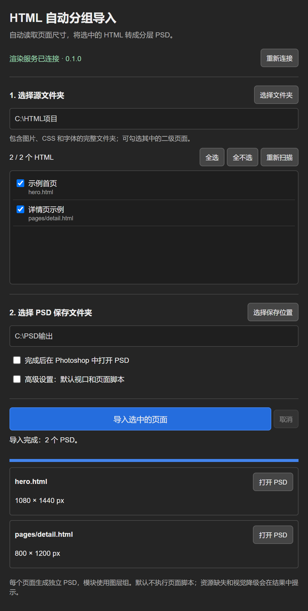

# HTML → Photoshop 自动分组导入

适合用于 AI 生成的 HTML 文件导入 PS 进行编辑。
使用Figma更推荐使用主页另一款插件HTML-Figma

面向 **Photoshop 2022（23.3）及以上** 的 UXP 插件。选择本地 HTML 项目文件夹，手动勾选首页或二级页面，自动识别尺寸，批量生成分层 PSD 并在 Photoshop 中打开。



界面预览（通用示例；浏览器中模拟 UXP 与渲染服务状态，用于展示面板交互，不代表原生安装验证，不含用户测试文件）。

每个 HTML 对应一个独立 PSD，使用普通图层组。普通文字保留为原生可编辑文字，图片、背景和装饰分别成层；SVG 外观转换为独立像素图层。

## 安装

完整包包含 UXP 面板和本地渲染服务，两部分都要保留。

### 先选一种获取方式

**方式一：下载完整包（推荐）**

到 [Releases](https://github.com/ricardo0426/html-to-photoshop-auto/releases) 下载最新的 `HTML自动分层导入-v0.1.0-完整包.zip`，解压到固定目录。完整包**已内置 npm 依赖**，不需要联网安装，直接按下面两步操作即可。

**方式二：从源码安装**

克隆或下载本仓库源码，解压到固定目录。源码**不含 `node_modules`**，首次双击「启动渲染服务.cmd」时会自动联网执行 `npm ci --omit=dev`。如果这台电脑访问 npm 受限导致安装失败，改用方式一的完整包。

### 第一步：安装面板

和普通 Photoshop 插件一样，不需要管理员权限，也不需要 UXP Developer Tool：

1. 把完整包解压到固定目录。
2. 双击 **安装插件.cmd**。脚本会把 `plugin` 复制到当前用户的 UXP 插件目录：

   ```
   %APPDATA%\Adobe\UXP\Plugins\External\HTML自动分组导入_v0.1.0
   ```

3. **完全退出 Photoshop**（不是最小化），再重新打开。
4. 顶部菜单 → **增效工具** → **HTML 自动分组导入**。

卸载双击 **卸载插件.cmd**。安装目录按 Windows 用户隔离，只对当前用户生效，也不影响 Photoshop 的其他版本。

> 该目录来自 UXP 日志中列出的 `upic::Loading plugins from user fallback plugins folder`。
> `HTML自动分层导入-v0.1.0.ccx` 是给 Adobe 安装器 / 上架流程用的打包产物，本地分发不需要它。

### 第二步：启动本地渲染服务

5. 安装 Node.js 20 或更新版本；本机已有 Chrome 或 Edge 即可。
6. 双击 **启动渲染服务.cmd**，保持服务窗口运行。
7. 面板顶部显示“渲染服务已连接 · 0.1.0”即成功。若显示未连接，先确认服务窗口还在，再点面板上的“重新连接”。

面板本身只是界面，网页排版和 PSD 生成都在本地渲染服务里完成，所以这个窗口必须一直开着。

本地服务默认监听 `127.0.0.1:38417`，只接受本机 UXP 插件的请求。启动脚本会自行定位 Node.js 与 npm（PATH 里找不到时回退到常见安装目录），依赖缺失时先试官方源，失败再自动改用国内镜像。没有 Chrome/Edge 时，可以在解压目录运行 `npx playwright install chromium`。

## 使用

1. 选择源文件夹或单个 HTML 文件：点“选择文件夹”导入整个项目；或点“选择 HTML 文件”只导入一个页面，插件会自动以该文件所在的文件夹作为根目录，并预先勾选它。相对资源（图片、CSS、字体）仍按所在文件夹解析，所以文件要放在完整的项目目录里。
2. 勾选需要导入的页面。仅导入二级页面时，点“全不选”，再手动勾选子文件夹中的 HTML。
3. 选择 PSD 保存文件夹。
4. 点击“导入选中的页面”。默认完成后在 Photoshop 打开 PSD，也可关闭自动打开。

页面尺寸自动推断；响应式页面默认使用 1440 × 900 视口排版，然后测量完整内容高度。固定宽度长页保留实际高度，明确的海报设计区域按其设计尺寸导出。高级设置可调整默认视口，或为可信页面开启脚本执行，例如使用 Tailwind CDN 的页面。

每批输出到新的 `HTML导入-时间-标识` 子文件夹，避免覆盖已有 PSD。文件名包含相对页面路径及短标识，重名 HTML 不会相互覆盖。输出文件夹附有 `导入报告.json`。

页面失败会记录原因，其余页面继续生成。取消后保留已完成的 PSD，停止当前及剩余任务。需要继续时重新勾选页面导入。

转换在本机进行。源 HTML 引用的远程资源，以及主动开启的页面脚本，会按源文件访问网络。

## 结果不对怎么排查

同一个 HTML 在不同电脑上可能得到不同结果。插件代码和依赖版本是固定的（`package-lock.json` 锁定 playwright 等版本），所以差异来自运行环境，按下面顺序检查：

| 现象 | 原因 | 处理 |
| --- | --- | --- |
| 整页没样式、布局塌成一列 | 页面依赖 JavaScript（Tailwind CDN、Vue/React 运行时等），但没有开启脚本 | 面板「高级设置」勾选「运行页面脚本」后重新导入 |
| 部分图片缺失 | HTML 引用远程图片，本机取不到。渲染时远程资源有 10 秒超时，超时即丢弃 | 把图片放到本地项目目录，或确认本机能访问该图床 |
| 字体与浏览器预览不一致 | 本机没装源 HTML 用的字体，Photoshop 使用了替代字体 | 装好对应字体后重新导入；`导入报告.json` 的 warnings 会列出被替换的字体 |
| 同一页面在两台电脑排版不同 | 回退到了不同浏览器（优先 Chrome，其次 Edge），版本差异导致渲染不同 | 两台电脑装同一版本 Chrome |
| 某些图层缺失或变成一张图 | 元素用了渐变文字、复杂滤镜、3D 或特殊混合等效果 | 见下方「可编辑性与限制」，报告里会列出被简化的项 |
| 报错「未找到可用的 Chrome / Edge」 | 本机既没有 Chrome 也没有 Edge | 安装 Chrome，或在解压目录运行 `npx playwright install chromium` |

每次导入都会在输出目录写 `导入报告.json`，里面每个页面都有 `warnings` 字段。定位问题先看它。

## 可编辑性与限制

- 普通文字使用 Photoshop 文字图层，包含字体、字号、颜色、字距和换行等信息。
- 浏览器能加载 WOFF/WOFF2 不代表 Photoshop 已安装该字体。插件读取 Photoshop 字体清单，缺少字体时使用替代字体并报告。
- 图片、背景、边框和 SVG 外观使用独立透明像素图层，可分别移动或替换。
- 结构容器使用图层组，普通圆角裁切使用矢量蒙版，支持的阴影保留为原生图层效果。
- 渐变文字保留像素预览，编辑原生文字后使用基础颜色，并在报告中提示。复杂滤镜、3D 和特殊混合等效果可能简化。
- Photoshop 重新排版文字后，行距、换行及抗锯齿可能与浏览器不同。
- PSD 单边上限为 30000 px，总计上限为 8000 万像素；超过时会报错，需要拆分页面。
- 支持可在浏览器中直接渲染的 HTML。不执行 React/Vue 项目构建，不持续监控目录，不自动沿链接抓取页面。

## 验证状态

开发阶段在 Photoshop 2025 中实际打开了 4 份生成的 PSD，并逐个修改了 40 个文字图层，均通过可编辑性检查。相关用户素材、PSD、截图和本机验证报告均未公开。

面板清单声明的最低版本是 Photoshop 2022 的 23.3（`manifestVersion: 5` 与 `apiVersion: 2` 的下限）。23.3～25.x 上的实际表现尚未验证：`photoshop.app.fonts` 取不到时插件会自动跳过字体匹配，不影响其他功能；`app.open` 打开 PSD 的流程在旧版行为未知。

这项验证覆盖转换出的 PSD 文件。UXP 面板安装、加载和完整原生交互流程仍待验证；面板接口已通过模拟 UXP/Photoshop 和浏览器检查。

## 源码开发

```sh
npm ci
npm run build
npm start
```

构建在 `dist/` 生成 CCX，不自动安装或发布。源码安装依赖后可直接以 `plugin/manifest.json` 加载面板。依赖固定在 `package-lock.json`。

| 目录或文件 | 作用 |
| --- | --- |
| `plugin/` | UXP 面板、manifest 与交互逻辑 |
| `src/server.mjs` | 本地服务、文件发现、任务队列和输出管理 |
| `src/renderer.mjs` | Chromium 渲染、自动尺寸与图层捕获 |
| `src/psd-writer.mjs` | PSD 分组、文字、像素、蒙版和效果 |
| `shared/` | 资源路径解析、自动尺寸和 DOM 捕获 |
| `scripts/build.mjs` | CCX 打包 |

## 许可

MIT。DOM 捕获部分来源于 Kevin Bryan 的 [Open HTML to Figma](https://github.com/kevicebryan/open-htmltofigma)，保留原许可与版权声明。依赖许可详见 [THIRD_PARTY_NOTICES.md](THIRD_PARTY_NOTICES.md)。
